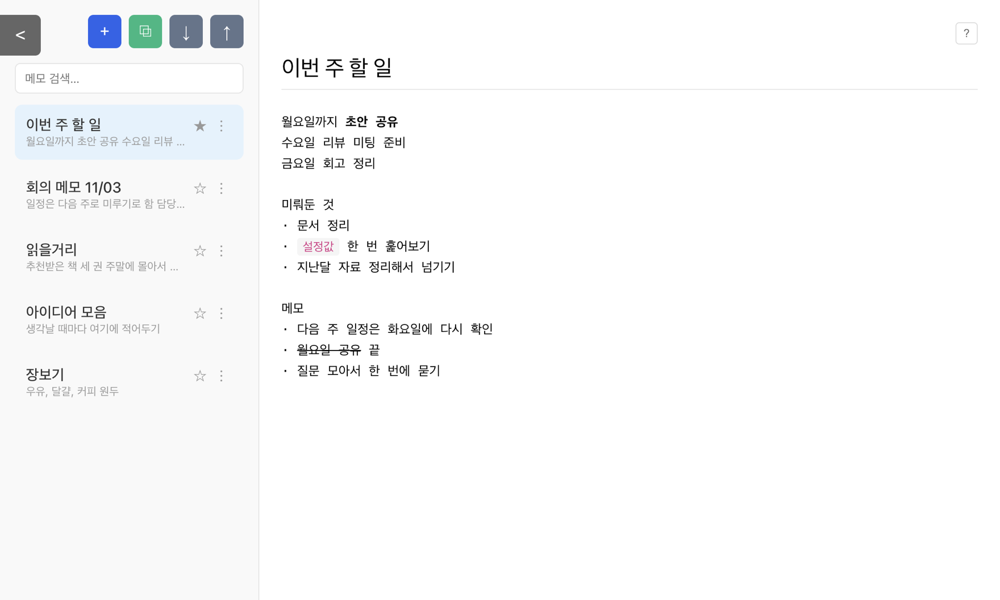

# MEMO

설치도 가입도 없이, 브라우저에서 바로 쓰는 가벼운 메모장입니다.

**→ 바로 쓰기: https://goun-vibe.github.io/memo/**



## 할 수 있는 것

- **저장 버튼이 없습니다.** 타이핑을 멈추면 알아서 저장되고, 창을 닫기 전에 한 번 더 저장합니다.
- **고정(★)** 으로 중요한 메모를 목록 맨 위에 둘 수 있습니다.
- **검색**은 제목과 본문을 함께 훑습니다.
- **서식과 되돌리기** — `⌘B` 굵게, `⌘U` 취소선, `⌘E` 코드, `⌘Z` 되돌리기. 되돌리면 커서도 제자리로 돌아옵니다.
- **내보내기(↓) / 가져오기(↑)** 로 메모 전체를 JSON 파일로 백업하고 다시 불러올 수 있습니다.
- 탭을 여러 개 띄워 두면 한쪽에서 고친 내용이 다른 탭에도 반영됩니다.

## 메모는 어디에 저장되나요

서버가 없습니다. 쓴 내용은 **브라우저의 localStorage에만** 저장되고 어디로도 전송되지 않습니다.

그래서 브라우저의 사이트 데이터를 지우면 메모도 함께 사라지고, 기기가 다르면 메모도 따로 저장됩니다. 중요한 메모는 ↓ 버튼으로 파일 백업을 받아 두세요.

## 직접 띄워 보기

의존성도 빌드 과정도 없습니다. 정적 파일을 그대로 띄우면 됩니다.

```bash
python3 -m http.server 8000
# http://localhost:8000/app/ 접속
```

`app/index.html` 한 파일에 화면과 로직이 전부 들어 있습니다. `file://` 로 직접 열어도 대개 동작하지만, 브라우저에 따라 localStorage가 막힐 수 있어 위처럼 서버로 띄우는 쪽을 권합니다.

## 구조

```
index.html       소개 페이지
app/index.html   메모장 본체 (화면 + 로직 전부)
app/index.css    기본 스타일
screenshot.png   소개 페이지에 쓰는 화면 사진
```

같은 `app/index.html` 이 Electron 데스크톱 앱에서도 그대로 돌아갑니다. Electron에서는 `preload.js` 가 주입하는 `window.electronAPI` 로 파일에 저장하고, 브라우저에서는 그 객체가 없으면 localStorage를 쓰는 대체 구현이 자동으로 들어갑니다.

## 라이선스

MIT
